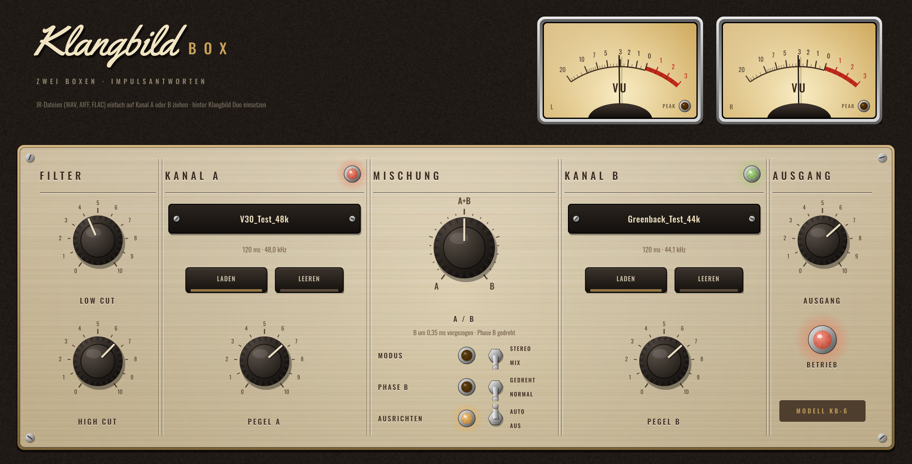

# Klangbild Box

Boxen-Simulation mit **zwei Impulsantworten (IRs)** – zum Mischen zweier Lautsprecher/Mikrofone,
mit automatischem Zeit- und Phasenabgleich. Audio Unit für Logic Pro (außerdem VST3 und Standalone),
gebaut mit [JUCE](https://juce.com).



## Funktionen

| Bereich | Regler | Was passiert |
|---|---|---|
| **Kanal A / B** | Laden, Leeren, Pegel | je eine IR (WAV, AIFF, FLAC – auch per Drag & Drop). Ohne IR wird das Signal durchgereicht |
| **Mischung** | A/B, Modus, Phase B, Ausrichten | **Mix**: stufenlos überblenden. **Stereo**: linker Eingang → IR A, rechter → IR B (passt direkt zum Stereo-Modus von Klangbild Duo), der A/B-Regler wirkt als Balance. **Ausrichten (AUTO)** sucht per Kreuzkorrelation die beste zeitliche Lage (bis 3 ms) und die richtige Polarität von B – keine Auslöschungen beim Mischen. **Phase B** dreht B zusätzlich von Hand |
| **Filter** | Low Cut, High Cut | 12 dB/Okt. (Standard 70 Hz / 9 kHz) – nimmt Rumpeln und Kratzen weg |
| **Ausgang** | Ausgang | Gesamtpegel, VU-Meter (0 VU = −18 dBFS) |

- IRs mit anderer Samplerate werden automatisch auf die Projekt-Samplerate umgerechnet.
- Beide IRs werden auf gleiche Energie gebracht, damit A und B ähnlich laut sind.
- IRs werden auf 500 ms gekürzt (Boxen-IRs sind meist 20–200 ms lang).
- Keine Latenz. Die Pfade der IRs werden im Logic-Projekt gespeichert.

### Signalweg in Logic
Gitarrenspur → Klangbild Kalibrator → Klangbild Duo (oder NAM) → **Klangbild Box** → Klangbild Raum

Für zwei Amps im Stereobild: Duo **und** Box auf *Stereo* stellen – dann läuft Amp A durch Box A
(links) und Amp B durch Box B (rechts).

### Woher bekomme ich IRs?
Viele Hersteller und Community-Seiten bieten kostenlose Boxen-IRs an (z. B. Tone3000, die Freebie-Packs
von OwnHammer, York Audio oder God's Cab). Am besten passt eine IR mit derselben Samplerate wie dein
Projekt, das ist aber kein Muss.

## Installation in Logic Pro

Tab **Actions** → letzter grüner Lauf → **Artifacts** → `Klangbild-Box-macOS`, dann:

1. `Klangbild-Box-AU.zip` entpacken → `Klangbild Box.component`
2. Finder → ⇧⌘G → `~/Library/Audio/Plug-Ins/Components` → Datei hineinkopieren
3. Einmal im Terminal:
   ```
   xattr -dr com.apple.quarantine ~/Library/Audio/Plug-Ins/Components/"Klangbild Box.component"
   ```
4. Logic starten: **Audio Units → Klangbild → Klangbild Box**

## Lizenzen

Schriften *Oswald* (OFL 1.1) und *Yellowtail* (Apache 2.0) – Lizenztexte in `Resources/`.
JUCE: AGPLv3 bzw. kommerziell – für den privaten Gebrauch unproblematisch.
